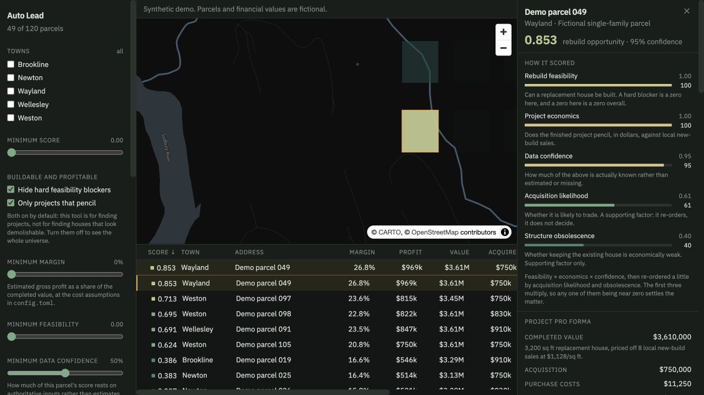
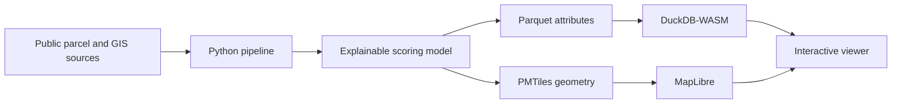

# Auto Lead

### Explainable property screening, from public GIS data to an interactive map.

Auto Lead explores a practical real estate question: which single-family parcels
might support a financially viable teardown and rebuild?

It combines parcel geometry, zoning standards, environmental constraints,
comparable sales, and a project cost model. Every result exposes its assumptions,
constraints, and data confidence so a user can investigate what drives the ranking.

**Python · DuckDB · NumPy · Next.js · TypeScript · DuckDB-WASM · MapLibre · PMTiles**

> **Public demo:** the bundled dataset contains 120 fictional parcels. Names,
> addresses, parcel IDs, boundaries, and financial inputs are not taken from real
> property records. The full pipeline downloads public source records locally;
> those records and generated outputs are excluded from Git.

[Run locally](#run-locally) · [Architecture](docs/architecture.md) ·
[Scoring and validation](docs/model.md) · [Development guide](docs/development.md)



## What you can explore

- **Map and table together.** Filter parcels, sort financial estimates, preview
  map selections, and open a detailed property analysis.
- **Explainable ranking.** Inspect feasibility, project economics, acquisition
  likelihood, structure obsolescence, and confidence separately.
- **Project economics.** Compare estimated acquisition, demolition, construction,
  financing, and sale costs against completed value.
- **Downside scenarios.** See how higher acquisition costs, construction overruns,
  and lower resale values affect margin.
- **Research workflow.** Save notes, status, and vetting checks in the browser;
  export and import annotations as JSON.

## How it works



The pipeline handles spatial joins and scoring offline. The browser reads static
artifacts directly and runs filters locally with DuckDB-WASM. MapLibre renders
parcel tiles, and a virtualized table keeps the interface responsive.

Optional authenticated market lookups run through server routes. They supplement
property research and do not change the offline ranking. The synthetic demo skips
these lookups.

## Engineering decisions

| Decision | Reason |
| --- | --- |
| Separate scoring from ingestion | The same NumPy model supports current builds, historical evaluation, and self-checks. |
| Use Parquet and PMTiles | Keep attributes queryable and geometry tiled without a spatial database at runtime. |
| Query in the browser | Filter changes avoid a server round trip after data loads. |
| Multiply core scores | A hard feasibility blocker forces the final ranking score to zero. |
| Track input provenance | Distinguish authoritative, estimated, and missing inputs. |
| Compare against simple baselines | Make model limitations visible rather than relying on an unexplained score. |

## Run locally

Requires **Node.js 20.9 or newer** and npm. The bundled demo runs without Python,
GIS downloads, provider credentials, or a database.

```sh
cd web
npm ci
cp .env.example .env.local
```

In `.env.local`, set `APP_ACCESS_KEY` to a random value of at least 24 characters.
Leave `NEXT_PUBLIC_ARTIFACT_BASE` blank to use the bundled demo.

```sh
npm run dev
```

Open [localhost:3000](http://localhost:3000) and enter your access key.

```sh
npm run check    # TypeScript
npm run build    # Validate artifacts and build the application
npm start        # Serve the production build
```

The first build fetches IBM Plex fonts from Google Fonts. Runtime data tools load
DuckDB-WASM from jsDelivr and the basemap from CARTO, so network access is required.

## Model scope and results

The full pipeline was developed against **36,296 single-family parcels** across
Brookline, Newton, Wayland, Wellesley, and Weston. That real dataset is not bundled
with this repository.

Scoring weights are configured expert assumptions, not learned parameters.
Historical evaluation reported the following results for completed-and-sold rebuilds:

| Ranking | AUC | Precision at 100 |
| --- | ---: | ---: |
| Combined opportunity score | 0.601 | 1.0% |
| Structure obsolescence baseline | 0.840 | 8.0% |

The simpler baseline predicts observed rebuilds better. The combined score also
asks about buildability and modeled economics, but its ability to identify
profitable deals remains unproven. Resale estimates carry substantial error, and
acquisition costs are estimated unless a listings export is supplied.

These figures describe a historical evaluation of real source data, not the
synthetic demo. See [validation details and caveats](docs/model.md#validation).

## Repository guide

```text
.
├── docs/                    Architecture, model notes, and development guide
├── pipeline/                Data ingestion, scoring, evaluation, and demo generator
│   ├── fixtures/            Schema for the synthetic demo
│   ├── config.toml          Model assumptions and source settings
│   └── zoning_minimums.csv  Municipal dimensional standards and source links
├── web/                     Next.js application
│   ├── app/                 Pages and authenticated API routes
│   ├── components/          Map, virtualized table, filters, and detail panel
│   ├── lib/                 Queries, types, annotations, sessions, and market clients
│   ├── public/              Synthetic demo artifacts
│   └── scripts/             Artifact validation and explicit private staging
└── README.md
```

Generated source caches and model outputs belong in `pipeline/data/` and
`pipeline/artifacts/`. Both are ignored, along with local credentials and imports.

For pipeline setup, demo regeneration, deployment, and private data workflows, see
[the development guide](docs/development.md).
